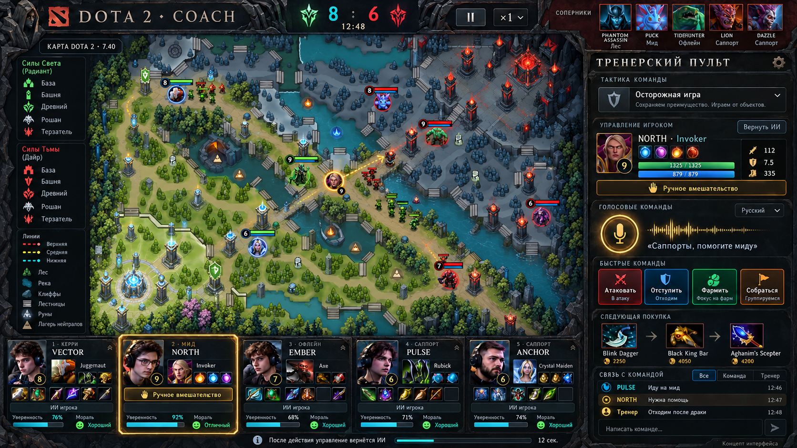

# Dota Coach

Видеоигра о тренере команды Dota 2: соберите состав из персональных цифровых
моделей игроков, подготовьте тактику и руководите матчем голосом. Мышью можно
ненадолго вмешаться в действия героя, затем управление возвращается его ИИ.

Цель — именно Dota 2 с собственной тренерской идеей. Возможность использования
оригинальных материалов исследуется; разрешение Valve пока не подтверждено.

## Быстрый старт по документации

- **[Рабочие библиотеки двух создателей](creators/README.md)** — новая работа начинается
  в своём разделе и подпункте; 24 раздела и 72 подпункта с действиями и приёмкой.
- [План создателя 1: сервер, ИИ, данные](creators/creator-1/PLAN.md).
- [План создателя 2: интерфейс, карта, голос](creators/creator-2/PLAN.md).
- [Первое обследование среды и Windows-запуск](creators/creator-1/01-foundation/01-environment-audit/README.md).
- [Текущая работа создателя 2: фундамент интерфейса](creators/creator-2/01-foundation/README.md).
- [Продолжение создателя 2 в локальном Codex на Windows](creators/creator-2/01-foundation/01-workspace-audit/notes/windows-start.md).
- **[Агенты.md](Агенты.md)** — быстрый поиск 172 ролей по номеру, категории и задаче.
- [Итоговые решения из диалога](docs/decisions.md) — требования, предложения и открытые вопросы.
- [Замысел игры](docs/project-brief.md) — сценарий тренера и цифровые игроки.
- [Поэтапный план](docs/roadmap.md) — 14 этапов и контрольные результаты.
- [Очередь разработки](docs/backlog.md) — 48 задач с зависимостями и критериями.
- [Навыки](docs/skills.md) — порядок применения Superpowers и необходимые компетенции.
- [AGENTS.md](AGENTS.md) — инструкции для работающих в репозитории агентов.

## Визуальный концепт

[Описание концепта и источник карты](docs/visual-concept.md). Изображение показывает
идею интерфейса; это не снимок работающего приложения. Портреты и ники вымышлены.

## Юридическое направление

- [12 юридических ролей и 10 задач](docs/legal/plan.md).
- [Первичный разбор и доступность источников](docs/legal/initial-review.md).
- [Черновик предложения Valve](docs/legal/valve-proposal.md) — не отправлен.

## Состояние проекта

Первый путь — кастомка внутри Dota 2 с Workshop Tools на Windows. Подготовлены
документация, концепт, две рабочие библиотеки и диагностические помощники.
Пользователь выбрал создателя 2; начат его интерфейсный фундамент. Помощник Panorama
проверен в облаке, исходники XML/CSS/JS панели и предложение ping подготовлены;
поведение панели проверяется без движка Dota. Добавлен
[сборщик пяти UI-ресурсов](creators/creator-2/01-foundation/02-panorama-capability/reports/source-bundle.md)
в отдельный каталог с отчётом SHA-256; это подготовка исходников к интеграции. Клон
`D:\AI\dota2coach` подтверждён пользователем; реальные пути Tools и запуск
панели с серверным ответом ещё требуют локальной проверки.
Приложение, импорт матчей, обученные модели и голосовое управление ещё не реализованы.
Патч, конкретные API и сборка выбираются по фактической установке Tools.

[Исторические планы](docs/archive/2026-10-08-roadmap.md) сохранены в архиве и
не определяют актуальные требования. Полный каталог обязанностей: [docs/agents.md](docs/agents.md).
