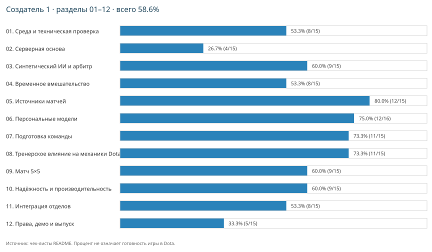

# Прогресс создателя 1

[План](PLAN.md) · [Как считается](00-progress/README.md)

**Всего: 58.6% — 106 из 181 действий.**

| Раздел | Выполнено | Прогресс |
|---|---:|---:|
| [01. Среда и техническая проверка](01-foundation/README.md) | 8/15 | 53.3% |
| [02. Серверная основа](02-runtime/README.md) | 4/15 | 26.7% |
| [03. Синтетический ИИ и арбитр](03-ai-baseline/README.md) | 9/15 | 60.0% |
| [04. Временное вмешательство](04-intervention/README.md) | 8/15 | 53.3% |
| [05. Источники матчей](05-match-data/README.md) | 12/15 | 80.0% |
| [06. Персональные модели](06-player-models/README.md) | 12/16 | 75.0% |
| [07. Подготовка команды](07-coach-preparation/README.md) | 11/15 | 73.3% |
| [08. Тренерское влияние на механики Dota](08-match-mechanics/README.md) | 11/15 | 73.3% |
| [09. Матч 5×5](09-full-match/README.md) | 9/15 | 60.0% |
| [10. Надёжность и производительность](10-reliability/README.md) | 9/15 | 60.0% |
| [11. Интеграция отделов](11-integration/README.md) | 8/15 | 53.3% |
| [12. Права, демо и выпуск](12-release/README.md) | 5/15 | 33.3% |

Это доля отмеченных действий, не оценка времени или готовности кастомки.
Готовые исходники не закрывают нативную проверку и приёмку второго создателя.

Обновление: `python creators/creator-1/00-progress/tools/update_progress.py`.
