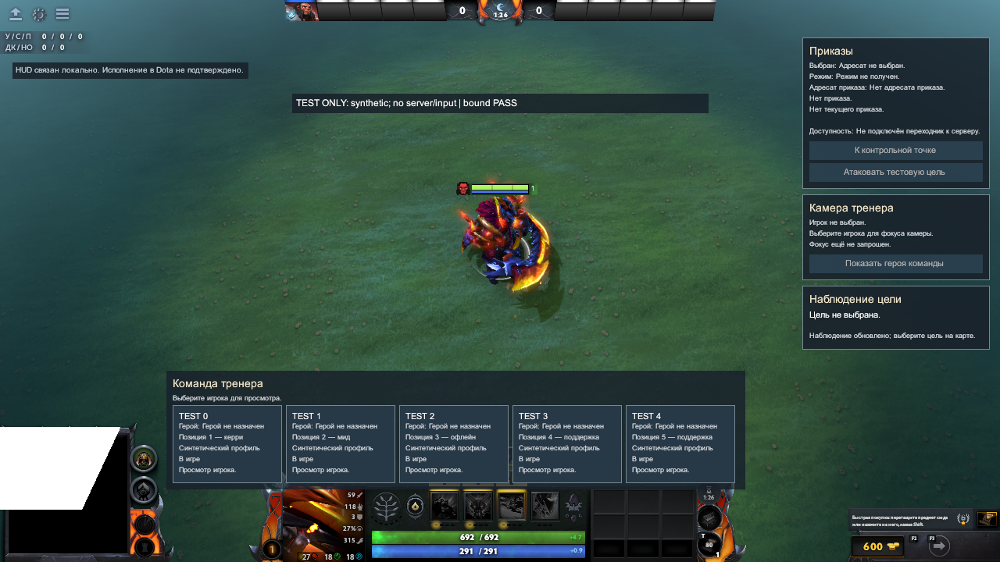
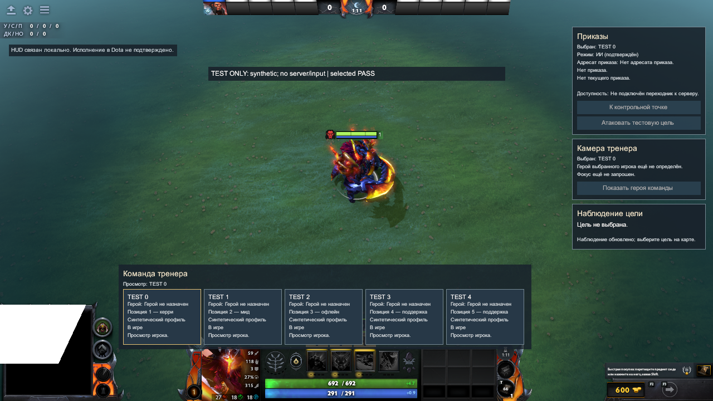
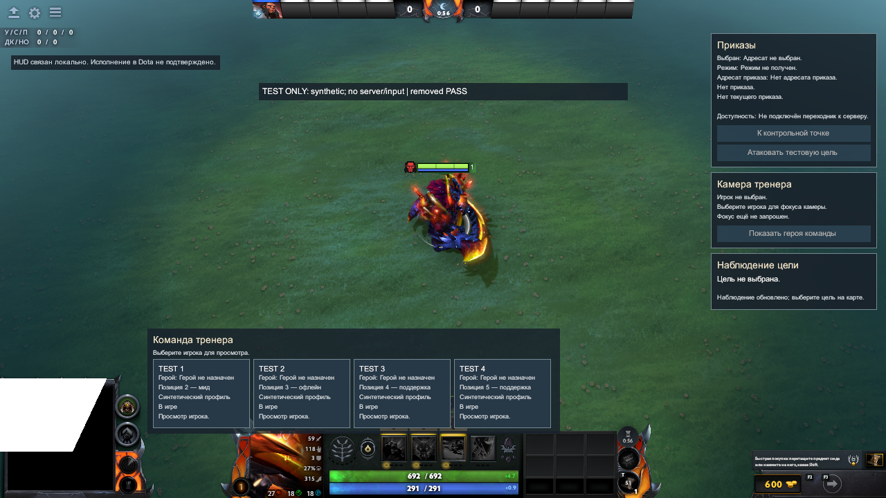
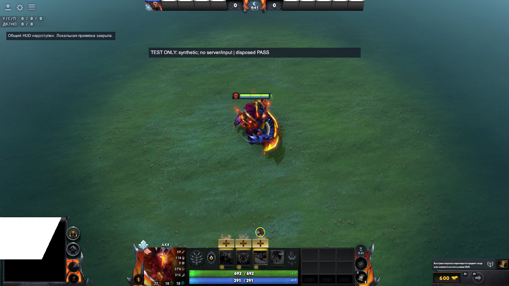
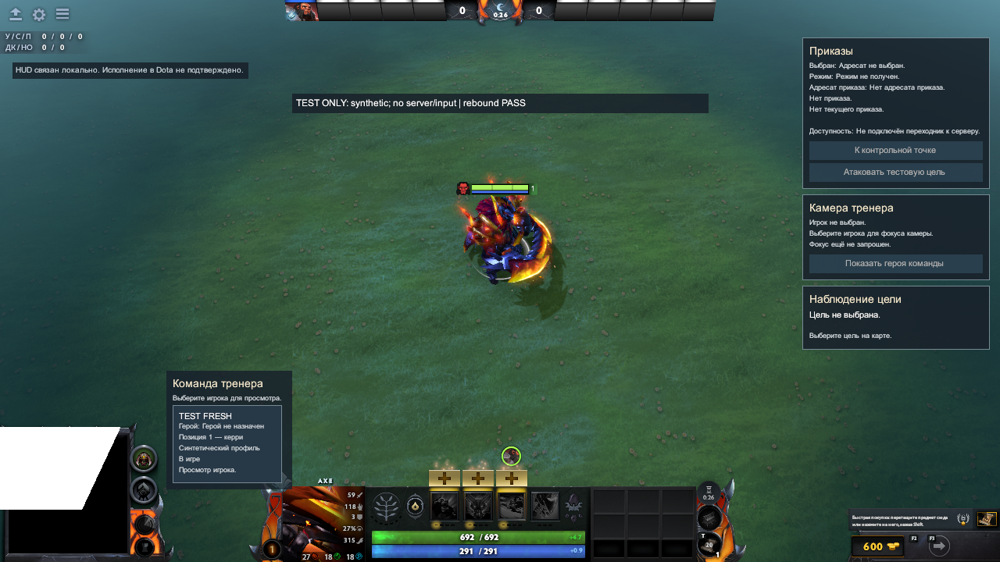

# Явная привязка HUD в настоящем Panorama

12 октября 2026. База `177f916e86cc4378d296e1c95201ef6d6e55346d`.
C2-11-01 / C2-11-02; ведущий — создатель2, интеграция Panorama и UI lifecycle.
[Спецификация](../native-binding-design.md) · [План](../native-binding-plan.md) ·
[Fixture](../tests/native-hud-binding/README.md) · [Предыдущий empty HUD](../../02-addon-packaging/reports/native-hud-scene-2026-10-12.md).

## Проверенный результат

Существующий DotaCoachHudPanels.bind реально исполнился в native Panorama.
Пять фаз и общий cycle PASS: пять TEST карточек; выбор TEST0; удаление выбранного
игрока; dispose; новый bind с TEST-FRESH и отказ старого handle без чтения DTO getters.
Пять actual engine кадров1280×720 осмотрены. Во всех активных фазах приказ/атака/
camera focus отключены. Игровой production JS/XML/CSS и fixed source kinds не менялись.

Карточки явно source=synthetic, heroName=null, TEST IDs. Это тестовые виртуальные
игроки, не реальные профили и не установленная связь с героем сцены. Clock nowMs=0;
options только now/maxAgeMs1000. Send, cameraGateway, resolveCameraEntity отсутствуют.
Выбор делается публичным selectPlayer, поэтому mouse click/hittest не проверен.
Подпись «Режим: ИИ (подтверждён)» на selected кадре — paint из TEST control DTO,
не серверное ACK и не наблюдение настоящего ИИ Dota. Предупреждение TEST видно постоянно.

## Fixture и native установка

[Builder](../../02-addon-packaging/tools/build_native_hud_fixture.py) применяет
прежние bounded read/output и exact HUD mapping/graph guards. Проверяет13 canonical
inputs; сохраняет12 из них без изменения bytes. Inert canonical manifest заменяется
только в отдельной fixture на test-only manifest; оригинальный layout сохраняется
как неизменённый input/output. Derived layout добавляет последний test script include
и plain TEST Label. Всего15source outputs. Это не новый fixed source kind.

Initial generated fixture: build/dota_coach/native-hud-binding-20261012T080412Z-27bdca.
После ужесточения проверки test manifest получен fresh final validation output:
build/dota_coach/native-hud-binding-20261012T081108Z-8fef91; hashes15assets
совпадают с initial/installed,13canonical source hashes и14compiled hashes
проверены повторно вместе с VPK. Generated outputs не редактируются.
Native report отдельно от source fixture report: source2_compiled/runtime flags
в generated report остаются false. Final builder хранит hashes всех13 canonical inputs.

Установка Dota: C:/Program Files (x86)/Steam/steamapps/common/dota 2 beta,
build_id25845666, Windows/PowerShell, bundled Python3.12.14/Node24.19.
Новый addon dota_coach_c2_hud_binding_20261012: content/game destinations отсутствовали.
Все15output hashes и14copied source hashes проверены до установки и после копирования.
Template map и addoninfo — отдельная Valve fixture с hashes из предыдущего native отчёта;
существующие addons/Steam/OS сохранены. Lua/C1/bootstrap/action transport не добавлялись.

```powershell
$dotaRoot = 'C:/Program Files (x86)/Steam/steamapps/common/dota 2 beta'
$contentRoot = "$dotaRoot/content/dota_addons/dota_coach_c2_hud_binding_20261012"
& "$dotaRoot/game/bin/win64/resourcecompiler.exe" -nop4 -game "$dotaRoot/game/dota" -i "$contentRoot/panorama/layout/custom_game/custom_ui_manifest.xml"
& "$dotaRoot/game/bin/win64/resourcecompiler.exe" -v -nop4 -game "$dotaRoot/game/dota" -i "$contentRoot/maps/template_map.vmap"
```

UI: exit0,1compiled/0failed; карта: exit0,13compiled/0failed. Native active graph
даёт14compiled UI outputs,95765байт. Число меньше15source outputs: retained inert
coach_hud.xml не включён test manifest; runtime загружает derived layout.
Эти числа не подменяются друг другом. VPK3033444байта,
SHA-256 `64d625a9dec71bdae013971a319dfbdde938996b4db98eaebae8f8e058e5328c`.
Compiler warning `Leaked KeyValues blocks:162` сохранён; причина не исследована.

## Native phases и actual screenshots

Owned PID21460, known launch flags1280×720 и отдельный fresh console log.
Live unique echo подтверждал VConsole; HERO_SELECTION использовал ранее проверенные
sv_cheats1/dota_pick_hero только для fixture. PRE_GAME08:09:07UTC (10:09:07Berlin).
Driver вызывает explicit bind один раз, ждёт native layout перед predicates,
и делает следующие шаги с15секундным интервалом. Capture выполняет screenshot
без аргумента через≥2секунды после phase record и до следующей фазы.
PNG получены из новых native TGA, без подстановки/генерации сцены.

| Фаза | UTC кадра | TGA | Проверено |
|---|---|---|---|
| bound | 08:09:11.998 | shot_0030 |5visible slots, positive native width/height, TEST/synthetic Labels |
| selected | 08:09:26.866 | shot_0031 |selected class, TEST0 у приказов и камеры, действия disabled |
| removed | 08:09:41.866 | shot_0032 |4visible slots, последний hidden, адресат очищен, TEST1 первый |
| disposed | 08:09:56.928 | shot_0033 |handle closed,4owned scopes hidden |
| rebound | 08:10:11.986 | shot_0034 |TEST-FRESH, old methods=false, DTO getters0reads, действия disabled |







Кадры подтверждают данные/выделение/очистку/скрытие/возобновление в этом layout.
Белый участок minimap template fixture остаётся. Нижний край пяти карточек близок
к верхним штатным элементам hero HUD; полноценный экран/адаптивность/взаимодействие
не принимаются этим smoke. Второе разрешение для populated fixture не проверено.
Quit отправлен, первая мгновенная PID-проверка ещё видела завершение процесса;
следующая проверка подтвердила PIDgone. Force kill/повторный quit не применялись.

## Проверки source и ограничения

Builder RED:6failures «builder missing»; при первом GREEN попытке отсутствовал
parent каталога test manifest — исправлен test fixture mkdir, не production policy.
GREEN6/6. Отдельный meaningful RED для executable onload attribute выявил
недостаточно строгую manifest проверку; exact tags/attributes/text и запрет DTD/entities
исправлены до финального GREEN7/7. Отказ происходит до создания output.
Existing HUD package20/20 и HUD binding26/26 PASS; fixture JS syntax PASS.

Full source report build/dota_coach/source-checks-20261012T080904Z-4ab77b/source-checks.json:
46suites/752passed_tests/6failed, verified=false. Failed suites python-c2-01-01,
python-c2-01-02, python-c2-03-01, python-c2-11-02, python-c2-10-01, python-c2-11-03.
Новые7Python checks входят в требуемый discover C2-11-02, но вся failed suite
исключается из passed_tests aggregate; их не прибавляем к752. Guards/skips/ошибки
WinError1314 не отключались, ОС/Developer Mode/права не менялись.

Source→bundle→installed/compiled hashes и fresh final output сверяются отдельно;
подробные15/14asset lists, PID/args/logs/captures/source report остаются локально
в build/dota_coach/native-hud-binding-* и указанном full source report.

Real C1/server/clock/visibility/identity, action authority/lease/возврат ИИ,
mouse/hittest/voice, полноценная карта/матч, full regression и другой создатель открыты.
AI critic не является рассмотрением другим владельцем. Dispose UI не означает
отмену запроса на сервере; в этом тесте запросов на сервер вообще не было.
