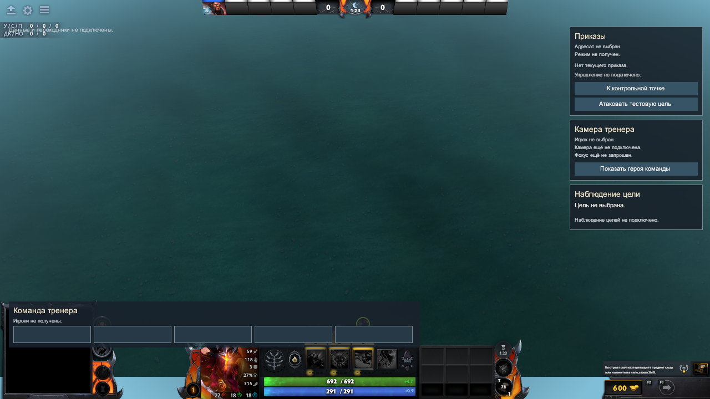
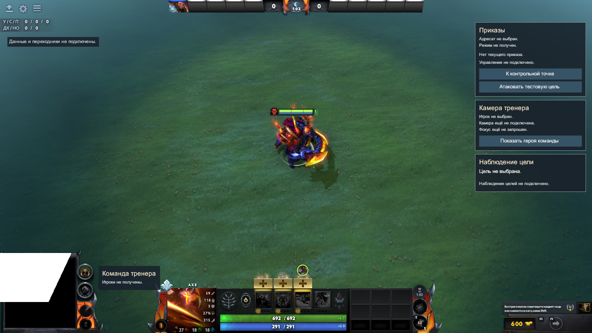
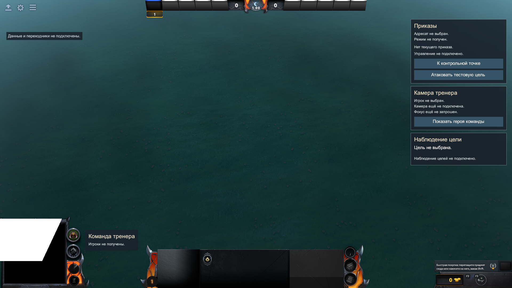
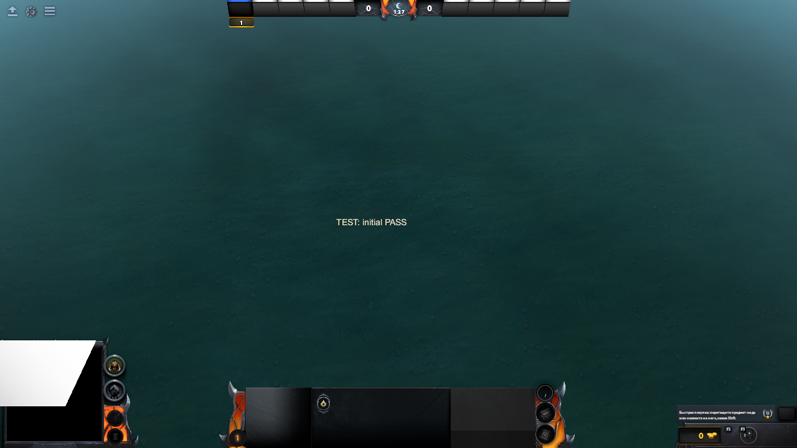
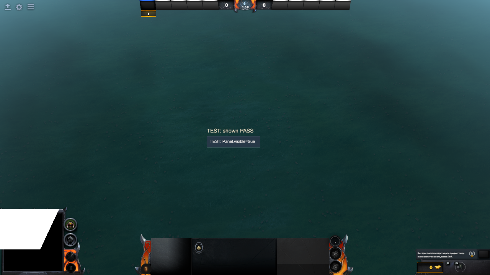
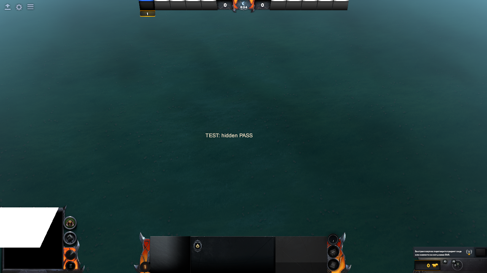
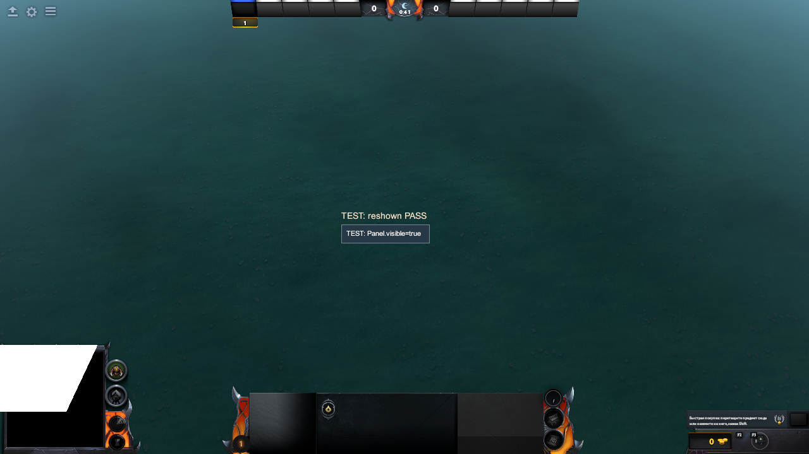

# Нативная сцена HUD: изображение и CSS

Дата: 12 октября 2026, Windows / Dota build_id 25845666.
База: `1119fb26aa5e68f502995b9c38e3c3eccdd4393c`.
Ведущий: создатель 2, C2-11-02 / C2-07-01, Panorama, layout и приёмка ресурсов.
[План](../native-scene-plan.md) · [Пакет](../README.md) ·
[Возобновление](../../../01-foundation/01-workspace-audit/notes/windows-resume.md).

## Результат и граница

Fixed inert HUD13/12 с десятью JS definitions реально загружен в отдельной
локальной Dota-сцене. Кадры 1280×720 и 1920×1080 показывают четыре пустые области:
состав, приказы, камера и цели. Первоначальные пустые рамки карточек и наложения
на штатную статистику/minimap исправлены в единственном canonical CSS.
Автоматическая привязка, игроки, sender и C1 bootstrap не добавлены.

Это частичная визуальная приёмка пустого HUD. Белый участок minimap штатной
template fixture виден на всех кадрах: полная сцена/карта визуально не принята.
Mouse/hittest, полный explicit bind, identity, серверные приказы, lease/возврат ИИ,
подтверждённые профили и рассмотрение другим создателем остаются открытыми.

## Исходники, установка и компиляция

Корень установки: `C:/Program Files (x86)/Steam/steamapps/common/dota 2 beta`.
Python 3.12.14 / Node 24.19.0. Fresh handoff создаётся штатным
`prepare_ui_handoff.py --screen hud`; последняя CSS-версия:
`build/dota_coach/probe-ui-20261012T064123Z-9e69fe`.
13 source→bundle→installed SHA-256 совпадают. Handoff хранит подтверждение
в `source_verification.package_verified`, не в предполагаемом top-level поле;
первая неверная проверка остановила установку до копирования.

Первый отдельный addon `dota_coach_c2_hud_scene_20261012` сохранён как defect fixture.
Исправленный — `dota_coach_c2_hud_scene_r1_20261012`. В обоих ровно 13 UI-ресурсов
fixed recipe; native fixture отдельно добавляет installed Valve template_map.vmap
и workshop_testbed/addoninfo.txt. Это не новые ресурсы HUD kind.
Lua/server/demo/probe и native bind отсутствуют.

```powershell
$dotaRoot = 'C:/Program Files (x86)/Steam/steamapps/common/dota 2 beta'
$contentRoot = "$dotaRoot/content/dota_addons/dota_coach_c2_hud_scene_r1_20261012"
& "$dotaRoot/game/bin/win64/resourcecompiler.exe" -nop4 -game "$dotaRoot/game/dota" -i "$contentRoot/panorama/layout/custom_game/custom_ui_manifest.xml"
& "$dotaRoot/game/bin/win64/resourcecompiler.exe" -v -nop4 -game "$dotaRoot/game/dota" -i "$contentRoot/maps/template_map.vmap"
```

Fresh UI: exit0, 1 compiled/0 failed; карта: exit0, 13 compiled/0 failed.
`-novpk` не используется: предыдущий подтверждённый отказ исключал base GAME VPK.
При последнем изменении отступа manifest incremental compile дал 0 compiled/1 skipped;
зависимый CSS не обновился. Явный `-i .../coach_hud.css` дал 1 compiled/0 failed.
Существующий клиент не показал свежий CSS; оба финальных кадра получены после
нового owned launch. Hot reload этим не подтверждён.
`Leaked KeyValues blocks: 162` сохранено в compiler log; причина не исследована.

Финальные 13 непустых UI outputs: 89073 байта. Ключевые hashes:

| Объект | SHA-256 |
|---|---|
| canonical coach_hud.css | `531f1e549c8bcc75b9aebcd3e69240f98ede4c2fd7d1323d2f3f6170340561de` |
| compiled coach_hud.vcss_c | `4c733d8d6e99771866a8efd80a4881bc9388b70077b5a1779bfa79ef905c2af4` |
| final template_map.vpk, 3033444 байта | `8da7abdb935716639429bf59253cc24dbe4a6dcef5f392f6b9ef24ba909abdc3` |
| installed template_map.vmap | `e135d73ba2ddc43e65b8b55f8b4ea345a04e3b686acd2056e303b53987604253` |
| installed addoninfo.txt | `adf8f0174eb786c269ad5b18c8023d696ad2d458996b283ba2f2991bb684bf4a` |

## Реальные кадры и коррекция

У нового owned client flags: `-game <game/dota> -steam -addon <name> -novid
-windowed -w <width> -h <height> -console -dev -insecure -vconsole -vconport 29000
-con_logfile <fresh repo log> +dota_launch_custom_game <name> template_map`.
Live unique echo подтверждал VConsole. После HERO_SELECTION штатный
`dota_pick_hero 0 npc_dota_hero_axe` использован только для local scene.
PRE_GAME зафиксирован; выбор этого героя не доказывает профиль/identity C1.
Доступная native команда `screenshot` вызывается без аргумента; PNG получены
из фактических новых engine TGA с сохранением размера и проверены визуально.

Первый кадр shot_0014 показал пять пустых рамок при XML visible=false,
status поверх штатной статистики и roster над minimap.
Native `dump_panorama_css_properties` подтвердил default visibility:visible
и collapse без участия в layout. Исправление только в canonical coach_hud.css:
default `.CoachHudCard { visibility: collapse; }`, roster margin-left320px,
status margin-top120px и читаемый фон. XML/JS/recipe/policy не изменены.



Финальный 1280×720: owned PID13232, PRE_GAME 06:47:23UTC, shot_0019.
Пустые рамки отсутствуют, status читается ниже статистики, roster справа от
круглых штатных индикаторов minimap. Центральная игровая область прозрачна.



1920×1080: owned PID1320, PRE_GAME 06:52:05UTC, shot_0020.
Те же четыре пустые области читаются; ни выбор карточек, ни input этим не проверены.



## Отдельная проверка native visible setter

[Test-only fixture](../tests/native-css-visibility/README.md) содержит собственные
manifest/layout/JS и повторно использует единственный canonical CSS. Её addon
`dota_coach_c2_css_visibility_20261012` не входит в HUD13 или fixed probe kind.
UI compile exit0/1 compiled, map exit0/13 compiled, explicit script compile exit0.
Нет игровой привязки, профилей, sender или тестовых приказов.

Первый цикл: initial=false/0×0; shown=true/140×30; hidden=false/140×30;
reshown=true/140×30, все native predicates PASS. Размер hidden сохранялся
как cached layout, поэтому сам getter/размер не принимается за видимый кадр.
Первая попытка кадра hidden попала между re-show setter и delayed phase label;
она исключена из доказательства скрытого изображения. Повторный owned run
получает кадр через две секунды после записи каждой фазы и до следующего setter.
Повторный owned PID2384: PRE_GAME 07:11:11UTC, все четыре native predicates
и общий cycle PASS. PNG всех четырёх фаз визуально проверены: initial/hidden
не показывают карточку, shown/reshown показывают рамку и её текст.
Сборщик первых фаз достиг общего timeout ожидания загрузки; продолжение сборщика
использовало уже полученный initial shot_0025, затем свежие кадры остальных фаз.
Timeout не объявляется успехом; полный итог четырёх кадров записан отдельно.

| Фаза | Engine TGA | UTC кадра | Native visible / cached width×height |
|---|---|---|---|
| initial | shot_0025 | 07:11:14.927 | false / 0×0 |
| shown | shot_0027 | 07:11:32.985 | true / 140×30 |
| hidden | shot_0028 | 07:11:46.003 | false / 140×30 |
| reshown | shot_0029 | 07:12:01.028 | true / 140×30 |






Успех отдельного setter доказывает только совместимость default CSS с
Panel.visible=true/false в этой fixture; полный roster binding остаётся открытым.

## Source-проверки и сохранённые данные

Новый source regression сначала RED: 20 tests/1 failure, у initial slot ожидался
collapse, разрешалось visible. После CSS — 20/20 PASS; existing HUD binding —
26/26 PASS. Regression разбирает только текущие plain class rules в source order,
не является реализацией полной CSS cascade или доказательством native layout.
Отдельный JS fixture прошёл `node --check`.

Полный Windows runner: 46 suites, 752 passed_tests, шесть failed suites,
`verified=false`. Требуемые symlink fixture ошибки WinError1314 и invalid_summary
из-за skips сохранены; никаких skip/изменений ОС/ослаблений guards для зелёного
статуса нет. Последний full report:
`build/dota_coach/source-checks-20261012T071058Z-365d47/source-checks.json`.
Failed suites: python-c2-01-01, python-c2-01-02, python-c2-03-01,
python-c2-11-02, python-c2-10-01, python-c2-11-03. Aggregate исключает passed
tests целиком failed suites, поэтому20 HUD tests не добавляются к752.

Generated source-only bundle/handoff не редактировались: source2_compiled/runtime
flags остаются false, installation/not_run остаются исходными. Native evidence
хранится отдельно. Точечные PASS не объявляются полной зелёной регрессией.

Ignored локальные артефакты в build/dota_coach: native-hud-scene-*-compile-20261012.log,
native-hud-scene-final-compiled-20261012.json, owned PID/launch args/console logs,
fresh VConsole capture JSONL, source-checks JSON и native-css-cycle2-captures-20261012.json.
Все созданные клиенты закрыты через quit с проверкой отсутствия owned PID;
Steam и чужие процессы не закрываются. Human second-owner review остаётся открытым.
