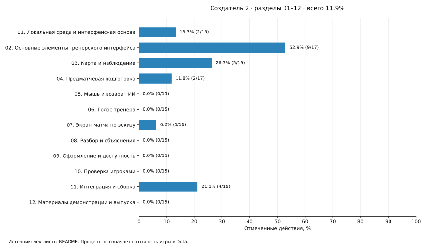

# Прогресс создателя 2

[План](PLAN.md) · [Как считается](00-progress/README.md)

**Всего: 20.1% — 42 из 209 действий.**

| Раздел | Выполнено | Прогресс |
|---|---:|---:|
| [01. Локальная среда и интерфейсная основа](01-foundation/README.md) | 2/15 | 13.3% |
| [02. Основные элементы тренерского интерфейса](02-coach-interface/README.md) | 10/18 | 55.6% |
| [03. Карта и наблюдение](03-map-view/README.md) | 5/19 | 26.3% |
| [04. Предматчевая подготовка](04-preparation-ui/README.md) | 2/17 | 11.8% |
| [05. Мышь и возврат ИИ](05-intervention-ui/README.md) | 1/16 | 6.2% |
| [06. Голос тренера](06-voice/README.md) | 3/16 | 18.8% |
| [07. Экран матча по эскизу](07-match-screen/README.md) | 6/20 | 30.0% |
| [08. Разбор и объяснения](08-analysis-ui/README.md) | 0/15 | 0.0% |
| [09. Оформление и доступность](09-presentation/README.md) | 0/15 | 0.0% |
| [10. Проверка игроками](10-user-testing/README.md) | 1/16 | 6.2% |
| [11. Интеграция и сборка](11-integration/README.md) | 12/27 | 44.4% |
| [12. Материалы демонстрации и выпуска](12-release/README.md) | 0/15 | 0.0% |

Это доля отмеченных действий, не оценка времени или готовности кастомки.
Готовые исходники не закрывают нативную проверку и приёмку второго создателя.

Обновление: `python3 creators/creator-2/00-progress/tools/update_progress.py`.
