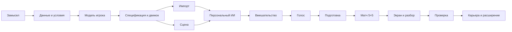

# Поэтапный план создания Dota Coach

Обновлено: 9 октября 2026 года. Статус: проектный план для рассмотрения.
В репозитории пока только документация: приложение, импорт данных, обучение и
тестовые команды ещё не реализованы. Сохранение этого плана не означает запуск работ.

Основание: [замысел проекта](project-brief.md).
Связанные документы: [задачи](backlog.md), [навыки](skills.md), [172 роли](agents.md).
Предыдущий план сохранён в [архиве](archive/2026-10-08-roadmap.md).

## Принцип последовательности

Сначала доказать, что доступны нужные данные и что персональные модели действительно
различаются. Затем проверить тренерское управление в небольшой сцене. После этого
собирать полноценный матч, подготовку команды и карьеру.

Голос, цифровые игроки и временное ручное вмешательство входят в первую играбельную
версию. Карьера и широкая библиотека контента развиваются после проверки этой основы.

## Техническое направление

Цель — именно Dota 2 с собственной тренерской идеей. Способ реализации выбирается
с учётом проверенных условий Valve. [Юридическая команда](legal/plan.md)
исследует основание для каждого варианта; разрешение ещё не подтверждено.

| Путь | Преимущество | Ограничение | Что проверить до выбора |
|---|---|---|---|
| Самостоятельная игра на основе Dota 2 | Контроль над ИИ, экспериментами, голосом и интерфейсом | Требуется установить подходящее основание на Dota-материалы; нужно создавать правила | Возможность лицензирования и точность переноса поведения |
| Режим внутри Dota 2 | Возможность использовать существующую игровую среду | Ограничения инструментов, управления ботами, голосовой интеграции и условий распространения | Официально поддерживаемые интерфейсы и возможность персонального ИИ |

Для ранней проверки алгоритмов — небольшая 2D-сцена. Путь выпуска Dota-проекта
зависит от исследованных условий и согласованных прав.
Для неё кандидат — TypeScript и Canvas с интерфейсом React; для обработки данных —
Python. Рабочая рекомендация — браузерная видеоигра с симуляцией в реальном времени.
Стек выбирается на P03 после проверки данных и требований. Обучение большой модели и покупка GPU заранее
в план не входят: сначала измеряется польза простой модели на доступных данных.

## Этап P00. Зафиксировать продукт и контрольные результаты

**Задачи:** закрепить сценарий тренера, различить цифрового игрока и героя, обозначить
первую версию и последующие расширения. Выделить три проверки: персональность ИИ,
управление голосом, возврат управления после вмешательства.

**Результат:** описание продукта и список решений до реализации.
**Переход:** пользователь может проверить, что план соответствует его замыслу;
несогласованные технические решения обозначены.
**Роли:** 1, 5, 7, 151. **Навык:** `superpowers:brainstorming`.

## Этап P01. Проверить данные и условия использования

**Задачи:** выяснить, что реально даёт dota2.ru: профили, идентификаторы, агрегаты,
события, ссылки на реплеи. Если подробных данных нет, проверить дополнительный
разрешённый источник с привязкой к матчам; выбранный сайт не считать готовым API.
Различить сетевой отказ и отсутствие данных. Проверить применимые условия на
данные, изображения карты, героев, имена и портреты игроков. Юридические задачи
LGL-001–LGL-010 выполняются по [отдельному плану](legal/plan.md).

**Результат:** таблица источников, происхождения, полей, патчей и ограничений,
примеры доступных данных и список реально недостающих данных.
**Переход:** известен уровень достижимой модели. Итоговая статистика позволяет
оценивать предпочтения, но не подтверждает возможность обучения микродействиям.
Если источник недоступен, независимая разработка работает с явно синтетическими
наборами; проверка реального сходства остаётся заблокированной.
**Роли:** 40, 102, 120, 161–172. **Навык:** `superpowers:brainstorming`.

## Этап P02. Спроектировать цифрового игрока и проверку сходства

**Задачи:** разделить навыки, стиль решений, владение героями и игровые черты характера.
Определить идентификаторы, версии, происхождение признаков и неопределённость.
Разделить матчи целиком на обучение, настройку и итоговую проверку; учитывать патч,
роль, героя и контекст. Последовательности одного матча не распределять между
обучением и итоговой проверкой. Не использовать сведения о будущем или скрытых врагах.

**Результат:** схема профиля, список извлекаемых признаков и протокол оценки.
**Переход:** каждое поле имеет источник либо пометку «игровая модель»; заранее
определены метрики, критерии принятия, база сравнения и минимально поддерживаемый
охват данных. Порог сходства выбирается до итоговой проверки и не подгоняется под неё.
Личность не выводится из побед и поражений.
**Роли:** 21, 23, 51, 102, 132, 142. **Навык:** `superpowers:brainstorming`.

## Этап P03. Выбрать движок и подготовить спецификацию первой проверки

**Задачи:** выбрать технический путь, один патч, один общий герой и роль для двух
профилей, правила сцены и формат команд. Определить карту как игровую структуру:
координаты, проходимость, высоты, обзор, точки появления, пути и объекты.
Картинка — только визуальный слой; версия карты должна совпадать с правилами и данными.

**Результат:** рассмотренная спецификация небольшой сцены и отдельный технический
план с файлами, интерфейсами и проверками. Нужные аппаратные ресурсы оценены.
**Переход:** выборы зафиксированы; до реализации рассмотрены спецификация и план.
**Роли:** 7, 31, 36, 41, 146. **Навыки:** `superpowers:brainstorming`, затем
`superpowers:writing-plans` после рассмотрения спецификации.

## Этап P04. Создать воспроизводимый импорт и первый набор данных

**Задачи:** реализовать адаптер источника, локальный импорт и преобразование данных.
Хранить исходные файлы отдельно от извлечённых признаков. Проверять версию формата,
игроков, героев, патч, временные метки, дубликаты и пропуски. Если нужны реплеи,
выбрать совместимый парсер и проверить его на целевом патче. Наблюдаемое состояние
и предполагаемое намерение игрока хранить раздельно.

**Результат:** два профиля на выбранной роли и герое с воспроизводимым происхождением.
**Переход:** повторный импорт не создаёт дублей, неверные файлы получают понятный
отказ, покрытие данных видно. Размер набора определяется наблюдаемой устойчивостью
оценок; «любые N матчей достаточно» не является правилом.
**Роли:** 40, 102, 106, 140. **Навыки:** выполнение плана, TDD, проверка результата.

## Этап P05. Создать испытательную сцену без сложной графики

**Задачи:** одна линия, крипы, два героя, башня, движение, атаки, попытки добивания
и деная, ресурсы и покупки из малого набора. Начать с общего ИИ как базы сравнения.
Использовать фиксированные шаги времени, управляемую случайность и журнал событий.

**Результат:** автономная сцена, которую можно запускать без интерфейса.
**Переход:** одинаковые входы воспроизводятся; здоровье и ресурсы корректны;
смерть, недопустимые цели, завершение и предел длительности определены.
**Роли:** 41–45, 48, 50, 112. **Навыки:** выполнение плана, TDD, проверка результата.

## Этап P06. Подключить персональный ИИ и доказать его отличие

**Задачи:** сначала параметризовать решения измеренными признаками: риск,
фарм, покупки, движение. Затем сравнить с обучаемой моделью выбора действий,
если позволяют данные. ИИ получает только доступное игроку наблюдение.
Профиль работает через общие правила героя, не отменяет их.

**Результат:** два профиля принимают различимые решения в общей сцене.
**Переход:** сравнение с общим ИИ и отложенными данными завершено. Оценивать по
поддерживаемым действиям: покупки, выбор цели, позиционирование, переключение задач.
Показать разброс оценок и неподдерживаемые случаи. Разница двух ИИ сама по себе
не доказывает сходства с двумя реальными людьми. Перенос из Dota в упрощённую сцену
оценивается отдельно, без заявления о полном цифровом двойнике.
**Роли:** 51, 57, 132, 142, 150. **Навыки:** TDD, проверка результата;
`superpowers:systematic-debugging` при расхождении.

## Этап P07. Реализовать временное вмешательство мышкой

**Задачи:** выбор одного своего героя; движение, атака, попытка добивания и деная,
изменение очереди покупок. Контроллер явно переключает режимы ИИ и вмешательства.
Рекомендуемый порядок: ручное действие → действующий приказ тренера → план команды.
После завершения, отмены или прерывания действия ИИ переоценивает текущую ситуацию.
Максимальная длительность вмешательства задаётся в спецификации.

**Результат:** игрок помогает герою и видит возврат к персональному ИИ.
**Переход:** смерть, потеря цели, смена выбора, пауза и окончание матча не оставляют
героя в зависшем режиме. Клик не гарантирует добивание: действуют здоровье, дальность,
скорость атаки и правила симуляции. Изменение покупки имеет обозначенные ограничения.
**Роли:** 69, 73, 76, 113, 156. **Навыки:** выполнение плана, TDD.

## Этап P08. Реализовать голос и единый интерфейс приказов

**Задачи:** цепочка «микрофон → распознанный текст → команда → адресат/цель →
проверка → исполнение → ответ». Начать с атаки, отступления, фарма и сбора команды,
с обращением по нику, роли или ко всем. Все способы ввода используют одни команды.

**Результат:** голосовой приказ меняет поведение в испытательной сцене.
**Переход:** неоднозначная или непонятная фраза не вызывает случайного действия;
показано, что услышано и что исполнено. Проверены запись настоящего голоса,
неразрешённый микрофон, ошибка распознавания, повтор команды, завершение записи
и задержка. Кнопки и текст позволяют продолжать при недоступном распознавании.
Способ обработки речи, требования сети и ресурсы выбираются в спецификации.
**Роли:** 61, 76, 77, 131, 156 с дополнительной специализацией по распознаванию речи.
**Навыки:** выполнение плана, TDD, проверка результата.

## Этап P09. Собрать состав и предматчевую подготовку

**Задачи:** выбрать пять разных игроков, роли и героев из поддерживаемого набора.
Обсудить план, распределить задачи и покупки; добавить короткую поддержку команды.
Доверие, мораль и дисциплину описать как отдельные игровые механики, пока нет
данных для их персональной оценки. Не подменять стиль произвольными бонусами.

**Результат:** сохранённая подготовка поступает в матч и видна в карточках.
**Переход:** нельзя скрыто назначить неподдерживаемую роль или профиль; предупреждение
о слабом покрытии данных понятно. Изменение тактики вызывает заранее описанное
изменение поведения в повторяемом сценарии.
**Роли:** 22–26, 61, 126, 129, 130. **Навыки:** проектирование, план, TDD.

## Этап P10. Расширить сцену до законченного матча 5×5

**Задачи:** перенести проверенные компоненты на карту с тремя линиями, базами,
башнями и лесом. Добавить обзор, командные цели, небольшой набор героев и предметов,
соперника и конец матча. Использовать отдельную проверку соответствия карты патчу.
Совместимость составов моделировать через координацию, ресурсы и выбор задач.

**Результат:** смешанный состав цифровых игроков проходит полный матч против ИИ.
**Переход:** матч завершается; информация о невидимых врагах не поступает ИИ;
взаимодействия героев и команд проверены. Несовпадение упрощённых правил с Dota
отражено в ограничениях. Не добавлять полный каталог героев до этой проверки.
**Роли:** 36–38, 41, 46–49, 57, 58, 141. **Навыки:** проектирование, план, TDD.

## Этап P11. Собрать тренерский экран и разбор матча

**Задачи:** карта с масштабированием и выбором, пять своих карточек, известные
сведения о противнике, голос, очередь покупок, журнал и статистика. Отделять портрет
человека от героя. Показывать текущую задачу, режим управления и надёжность профиля.
Добавить начало, паузу, скорость, новый матч, итог и воспроизводимый повтор событий.
Объяснения привязывать к зарегистрированным решениям, а не придумывать постфактум.

**Результат:** полный сценарий «подготовка → матч → разбор → новый матч».
**Переход:** рабочие элементы доступны мышью и клавиатурой; новый матч сбрасывает
старое состояние; повтор использует те же версии правил, профилей и карты.
Концепт-картинка не считается доказательством готовности интерфейса.
**Роли:** 71–80, 105, 131–135, 157. **Навыки:** план, TDD, проверка результата.

## Этап P12. Проверить первую играбельную версию

**Задачи:** автоматический полный сценарий, пакетные матчи, реальные голосовые
проверки, плейтесты и измерение времени работы симуляции. Отдельно проверить качество
профилей, действие подготовки, приказов и ручного вмешательства. Ресурсы и задержку
сравнить с заранее выбранным целевым устройством; не объявлять все платформы поддержанными.

**Результат:** отчёт по всем обязательным проверкам и воспроизводимый прототип.
**Переход:** пройден сквозной сценарий; нет необъяснённых зависаний и повреждений
состояния; пределы сходства и известные ошибки опубликованы в документации.
Если реальные данные отсутствуют, готовность называется «прототип механик»,
а не «версия с проверенными цифровыми игроками».
**Роли:** 111–114, 118, 122, 124, 141–145, 150, 155. **Навыки:** проверка результата,
ревью; системная диагностика при сбоях.

## Этап P13. Расширение после проверки основы

Разрабатывать отдельными спецификациями и планами:

1. Больше игроков, героев и патчей; переоценка профилей и обозначенные случаи общего ИИ.
2. Драфт, тренировки, отношения, сыгранность и помощник тренера.
3. Карьера: календарь, турниры, трансферы, контракты, бюджет и сохранения с миграциями.
4. Редакторы контента, баланс, локализация, оформление и звук.
5. Подготовка выбранного выпуска: права, совместимость, установка, обновления.

**Результат:** каждая новая подсистема добавляет проверяемый игровой сценарий.
**Переход:** предыдущие проверки не ухудшились; права на выпускаемые материалы
установлены. Сетевой режим и полный аналог всех механик Dota — отдельные проекты.
**Роли:** 11, 27–30, 38, 59, 81–110, 120, 126–130, 136–140, 159.
**Навыки:** проектирование → план → выполнение → ревью → проверка результата.

## Контрольные версии

| Версия | Что пользователь получает | Что ещё не обещаем |
|---|---|---|
| V0 — P00–P03 | Проверенный план данных, модель профиля и спецификация проверки | Готовый персональный ИИ |
| V1 — P04–P06 | Две модели, небольшая сцена и отчёт о сходстве | Полный матч и воспроизведение характера человека |
| V2 — P07–P09 | Голос, короткое вмешательство, состав и подготовка | Полную карту и все герои |
| V3 — P10–P12 | Матч 5×5, экран и разбор с проверками | Точную копию Dota и готовую карьеру |
| V4 — P13 | Последовательное расширение в полноценную игру | Автоматическую поддержку всех игроков и патчей |

## Зависимости и параллельная работа

После общих контрактов импорт P04 и сцена P05 выполняются независимо. На P03 можно
описать интерфейс и подготовить статичный макет, но его интеграция проверяется на P11.
Исследование голоса может идти раньше P08; исполнение приказов зависит от контроллера.
Если P04 или проверка реального сходства P06 заблокированы, интерфейс, голос и
вмешательство можно проверять на явно синтетическом профиле общего ИИ. Такая ветка
даёт прототип механик; переход к версии с проверенными цифровыми игроками требует
реальных данных и завершённой оценки.
Число одновременных исполнителей ограничено средой. 172 роли — каталог специализаций.

## Управление неопределённостью

| Неопределённость | Как проверяем | Что делаем при отрицательном результате |
|---|---|---|
| Нет событий матчей или реплеев | P01, образцы данных | Используем явно ограниченные профили; ищем разрешённый подробный источник |
| ИИ не похож на игрока | P06, отложенные матчи и общий ИИ | Пересматриваем признаки и охват; не заявляем оцифровку доказанной |
| Упрощённая сцена меняет стиль | P06, перенос и одинаковые сценарии | Уточняем правила или выбираем другой технический путь |
| Голос плохо распознаётся | P08, настоящая речь и измеренная задержка | Уточняем словарь и распознавание; сохраняем альтернативный ввод |
| Не установлены основания на Dota-материалы | P01, P03 и перед выпуском | Выясняем разрешённый формат и маршрут согласования; механики проверяем отдельно, цель Dota-проекта сохраняем |
| ИИ слишком дорогой | P06 и P12, измерение CPU/памяти/задержки | Упрощаем модель, частоту решений, кэширование; ресурсы покупаем по измерениям |

## Дисциплина выполнения

Для каждой подсистемы: краткая спецификация → рассмотрение → подробный технический
план → рассмотрение → выполнение и проверки. Эта дорожная карта не заменяет точные
интерфейсы, правила и команды будущего плана. Навыки подключаются по задаче,
как описано в [skills.md](skills.md), без загрузки всех навыков одновременно.

Даты выпуска не назначаются до P03 и первых измерений P04–P06. Оценки учитывают
импорт, обучение, симуляцию, голос, интеграцию и проверку как отдельные работы.
Ближайший результат — спецификация данных и цифрового профиля (P01–P03).
